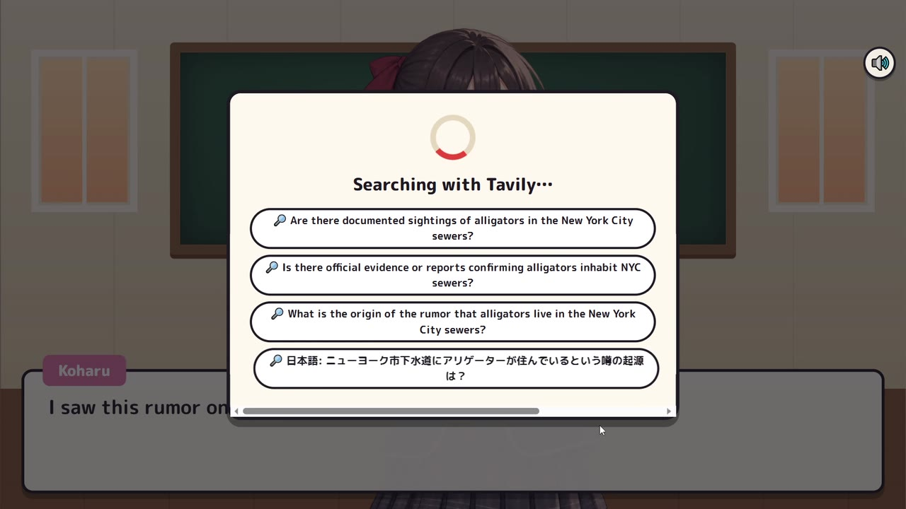
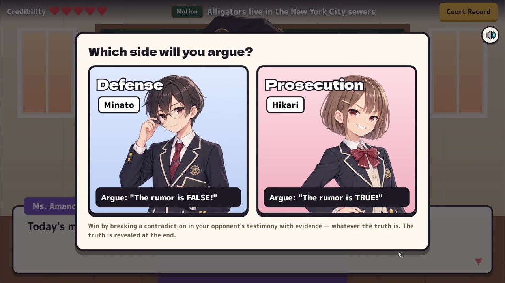
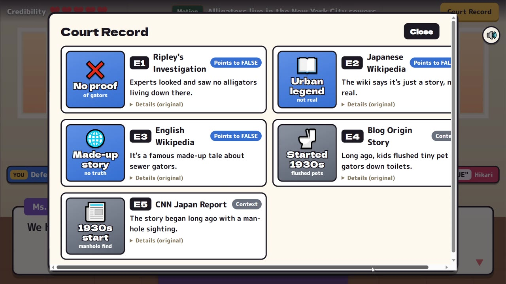
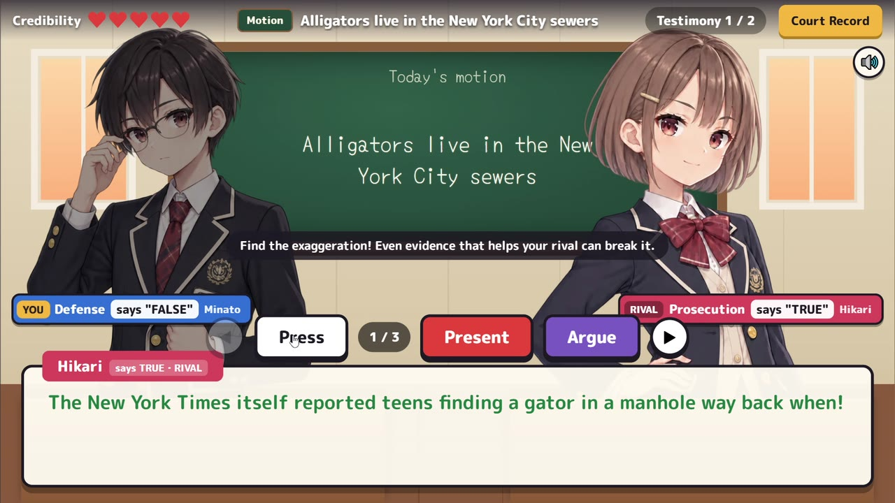
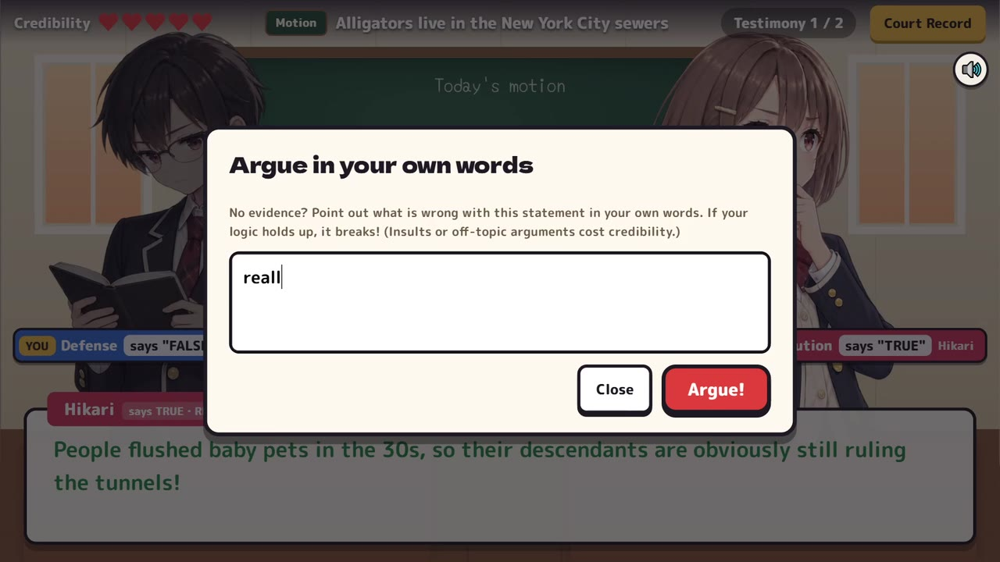
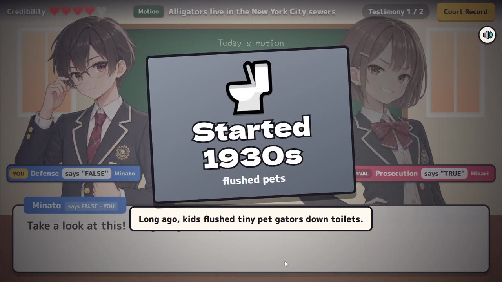
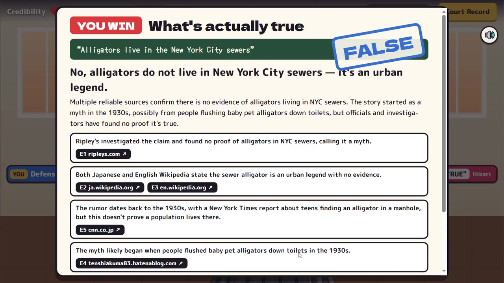
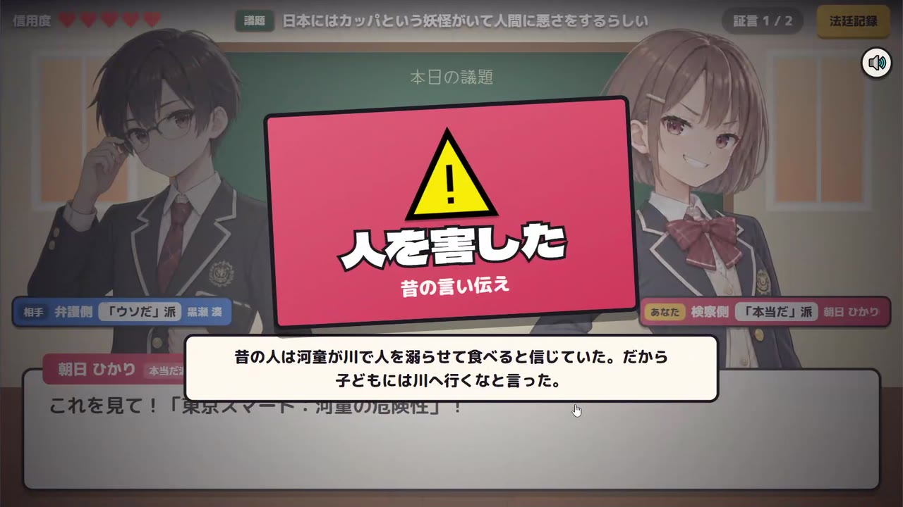

# うわさ裁判（Rumor Court）

[English](README.md) | **日本語**

**ネットのうわさを、証拠で裁け。**

「うわさ裁判」は、中高生向けの法廷ディベートゲームです。ネットで見かけたうわさ（「ニンジンを食べると夜目がきく」「金魚の記憶は3秒」など、何でも入力できます）を持ち込むと、AIがその場でウェブを調べ、本物の情報源を**証拠品カード**にします。続いて相手役のAIが証言します。プレイヤーは証言をゆさぶり、**ウソを崩す証拠品をつきつけ**ます。最後に、すべての出典リンク付きで**「本当のところ」**が明らかになります。

面倒な「ファクトチェック」を、「言いすぎ」「出典の読み違い」「一部と全部のすり替え」を見抜くゲームに変えました。

- **デモ：https://rumor.kitakuarcade.com**
- 部門：**Best Apps and Agents**
- 使用技術：**NVIDIA Nemotron 3（Nano / Super / Ultra）on Nebius Token Factory**、**Tavily Search API**
- 言語：日本語 / 英語

---

## スクリーンショット

すべて実際の LIVE プレイ（うわさ「Alligators live in the New York City sewers」）の画面です。

| | |
|---|---|
|  **タイトル** — 英語 / 日本語 |  **LIVE 調査** — Nemotron Nano が検索語を考え、Tavily がウェブを調べる |
|  **陣営を選ぶ** — 本当だ派か、ウソだ派か |  **法廷記録** — 本物の情報源が証拠品カードになる |
|  **尋問** — ゆさぶる・つきつける・つっこむ |  **つっこむ** — 自分の言葉の理屈を Nemotron が判定 |
|  **つきつける** — 発言を崩す証拠品を出す |  **Wait!** — ウソが崩れる瞬間 |
|  **2回目の証言** — 相手が負けを認めて作戦を変える |  **本当のところ** — 要点ごとに出典リンク付き |
|  **日本語版** — 同じゲームを日本語で | |

---

## しくみ

```
 うわさ ──► Nemotron Nano：安全チェック＋検索の計画（英語＋うわさの言語で3〜4件の検索語）
             │
             ▼
        Tavily Search（advanced 深度、並列検索、URLで重複除去）
             │  本物のURLと抜粋
             ▼
        Nemotron Super：証拠係 — 信頼できる結果を5〜7件選んで証拠品カードにする
             │  （本当寄り / ウソ寄り / 背景、信頼度）。カードは Tavily の実際の検索結果からしか
             │  作らない。モデルが作り出したURLはサーバー側で捨てる。
             ▼
        Nemotron Ultra：相手の証言を書く（3つの発言のうち、特定の証拠品で崩せる
             │  ボロがちょうど1つ）＋「ゆさぶる」への返答＋異議のセリフ
             ▼
 プレイヤーがつきつける ──► 想定の正解？ → すぐ判定
                            それ以外   → Nemotron Nano が、その証拠でも本当に発言が
                                          崩れるかを判定（別解も認める）
             ▼
        Nemotron Ultra：最後の「本当のところ」カード — 判定ラベル、まとめ、
                        証拠にひもづいた要点、メディアリテラシーのヒント
```

### Nebius Token Factory 上のモデルの使い分け

| 処理 | モデル | 理由 |
|---|---|---|
| 安全チェック＋検索の計画 | `nvidia/NVIDIA-Nemotron-3-Nano-30B-A3B` | 速くて安い。新しいうわさのたびに動く |
| 検索結果から証拠品を作る | `nvidia/nemotron-3-super-120b-a12b` | 長い文脈を正確に読み、決まった形で出力できる |
| 相手の証言（ボロを1つ仕込む） | `nvidia/Nemotron-3-Ultra-550b-a55b` | 公平で、見抜ける矛盾を仕込むには高い推論力が必要 |
| 想定外のつきつけの判定 | Nemotron 3 Nano | プレイ中に何度も出る、すばやい Yes/No 判定 |
| **つっこむ** — プレイヤーの自由入力の理屈を判定 | Nemotron 3 Super | 理屈を「有効 / 弱い / 無効」に分類（一般化しすぎ、体験談は証明にならない、相関と因果など）し、キャラとして返答 |
| 最後の判決カード | Nemotron 3 Ultra | 証拠だけにもとづいた、慎重な結論 |

### Nebius Token Factory で開発が速くなったところ

- **1つのクライアントで3サイズ。** OpenAI 互換のエンドポイント（`https://api.tokenfactory.nebius.com/v1/`）のおかげで、依存パッケージなしの約100行のクライアント（`server/llm.js`）から、モデル名を変えるだけで Nano・Super・Ultra を呼べます。GPU の用意もモデルのホスティングも不要です。
- **処理ごとにちょうどいいサイズ。** 全サイズが同じAPIの裏にあるので、各処理は「その仕事を十分こなせる一番小さいモデル」を使います（細かい判定は Nano、慎重な推論が必要なところだけ Ultra）。これで待ち時間と費用を、公開デモを動かせる水準に抑えています。
- **構造化出力。** `response_format: json_object` と `chat_template_kwargs: {enable_thinking: false}` で、ゲームの処理に使える JSON を速く受け取れます。推論でトークン上限を使い切った場合は、自動で上限を増やして再試行します。
- **サーバーレスの従量課金** なので、GPU サーバーではなく小さな VPS（Node.js + nginx）で、1日・1か月の上限付きでデモを動かせます。

### Tavily

Tavily はゲームの探偵役です。新しいうわさごとに、`search_depth: "advanced"` の検索を3〜4件並列で行います（ファクトチェック、公的機関・科学的な根拠、うわさの起源、うわさの言語での検索）。結果は URL で重複を除き、Tavily の関連度スコアで並べてから Nemotron Super に渡します。証拠品カードはすべて出典 URL を持っているので、法廷記録と最後の判決カードから元のページを開けます。

### 費用と乱用への対策

- ディスク＋メモリのキャッシュ：同じうわさ・証言・判定は二度と生成しません。
- 判決と次の証言は、プレイヤーが会話を読んでいるあいだに**先に生成**しておくので、待ち時間が短くなります。
- 新しいLIVE調査には上限があります：IPごとの回数制限と、1日・1か月の上限（初期値は `LIVE_CASES_PER_IP_PER_HOUR`=3、`LIVE_CASES_PER_DAY`=10、`LIVE_CASES_PER_MONTH`=100）。回数は再起動しても保持されます。
- 個人を標的にしたもの、性的な内容、自傷、ヘイト、危険な手順に関するうわさは、Nano の安全チェックで受け付けません。

---

## インストール手順

### 1. 必要なもの

- **Node.js 18 以上**（https://nodejs.org）。npm パッケージは使わないので、`npm install` は不要です。
- Git（または GitHub から ZIP をダウンロード）
- LIVE モードで遊ぶ場合：**Nebius Token Factory の API キー** と **Tavily の API キー**。キーがなくてもデモモードで動きます。

### 2. API キーを用意する（LIVE モードのみ）

| キー | 取得先 | メモ |
|---|---|---|
| `NEBIUS_API_KEY` | Nebius Token Factory — https://tokenfactory.nebius.com で API キーを作成 | Nemotron 3 Nano / Super / Ultra に使用 |
| `TAVILY_API_KEY` | Tavily — https://app.tavily.com の API Keys | 無料プラン（月1,000クレジット）で試せます。新しいうわさ1件で約6〜8クレジット |

### 3. ダウンロードと設定

```bash
git clone https://github.com/tinycore-hisanori/rumor-court
cd rumor-court
cp .env.example .env        # Windows（コマンドプロンプト）では: copy .env.example .env
```

`.env` をテキストエディタで開き、キーを書き込みます。

```
NEBIUS_API_KEY=あなたのNebiusキー
TAVILY_API_KEY=あなたのTavilyキー
```

`.env` は絶対に公開しないでください（`.gitignore` で除外済みです）。

### 4. 起動

```bash
npm start
```

ブラウザで **http://localhost:8787** を開きます。キーが2つとも読み込まれると、画面（コンソール）に `[LIVE: Nemotron on Nebius + Tavily]`、なければ `DEMO mode` と表示されます。`http://localhost:8787/api/status` でも確認できます（`"mode":"live"` または `"demo"`）。

- **LIVE モード**（キーが両方あるとき）：一覧から選ぶか、好きなうわさを入力すると、その場で調査します。
- **デモモード**（キーなし）：本物の出典付きの事件2本を、オフラインで遊べます。
  LIVE モードでも、この2本は同梱データから読み込むので、デモが失敗することはありません（`LIVE_PRESETS=1` で、これらもLIVEで調査します）。

### 5. 追加の設定（`.env`）

| 変数 | 初期値 | 意味 |
|---|---|---|
| `PORT` | `8787` | 待ち受けポート |
| `LIVE_CASES_PER_DAY` / `LIVE_CASES_PER_MONTH` | `10` / `100` | **新しい** LIVE 調査の上限（調査済みのうわさは無料） |
| `LIVE_CASES_PER_IP_PER_HOUR` | `3` | 1人あたりの上限 |
| `MODEL_NANO` / `MODEL_SUPER` / `MODEL_ULTRA` | Nemotron 3 の各モデル | Token Factory 上の別モデルに差し替え可能 |
| `NEBIUS_BASE_URL` | `https://api.tokenfactory.nebius.com/v1/` | Token Factory のエンドポイント |
| `NEMOTRON_ENABLE_THINKING` | オフ | `1` で回答前に推論させる（遅く、トークンも多く使う） |
| `HIDE_BUNDLED_CASES` | オフ | `1` で LIVE モードでは `rumors.txt` の一覧だけを表示 |

### 6. Linux サーバーで公開する（任意）

`deploy/` フォルダに systemd の設定と nginx のリバースプロキシ設定があります。

```bash
sudo mkdir -p /opt/rumor-court && sudo cp -r . /opt/rumor-court/
sudo cp .env /opt/rumor-court/.env && sudo chown -R www-data:www-data /opt/rumor-court
sudo cp deploy/rumor-court.service /etc/systemd/system/
sudo systemctl daemon-reload && sudo systemctl enable --now rumor-court
# nginx: deploy/nginx-rumor.conf の server_name を自分のドメインに書き換えてから
sudo cp deploy/nginx-rumor.conf /etc/nginx/sites-available/rumor-court
sudo ln -s /etc/nginx/sites-available/rumor-court /etc/nginx/sites-enabled/ && sudo nginx -t && sudo systemctl reload nginx
```

新しい LIVE 調査は30〜90秒かかるので、`proxy_read_timeout` は長めにしておいてください。HTTPS はいつもの方法（certbot や Cloudflare のオリジン証明書など）で設定します。

### うわさの一覧（`rumors.txt`）

`rumors.txt` を編集すると、うわさを選ぶ画面の一覧を変えられます。1行に1つで、`日本語 | English` の形で両方の言語を書けます（最大30件）。
ファイルは毎回読み直すので、再起動はいりません。一覧から選ばれたうわさは、その場でLIVE調査します。
`HIDE_BUNDLED_CASES=1` にすると、LIVE モードでは一覧のうわさだけを表示します。

### Docker / Nebius Serverless Endpoints

```bash
docker build -t rumor-court .
docker run -p 8080:8080 -e NEBIUS_API_KEY=... -e TAVILY_API_KEY=... rumor-court
```

コンテナは `$PORT`（Docker では初期値 8080）で待ち受けるので、Nebius Serverless Endpoint やほかのコンテナ環境にそのまま置けます。

### 操作

**つっこむ**（A、LIVE モード）：証拠がなくても、自分の言葉で理屈を書けば、Nemotron がその理屈で本当に発言が崩れるかを判定します。2回はずすと天野先生がヒントをくれます。

クリック / Enter：次へ ・ ◀ ▶ / 矢印キー：発言の切り替え ・ **ゆさぶる**（P）：くわしく聞く ・ **つきつける**（E）：証拠を見せる ・ **法廷記録**：証拠を全部読み、出典を開く ・ **M**：音のオン/オフ

---

## ファイル構成

```
server/server.js     HTTP サーバー、API、キャッシュ、回数制限、デモ用データ
server/game.js       プロンプトと検証：事件ファイル、証言、異議の判定、判決
server/llm.js        Nebius Token Factory クライアント（Nano / Super / Ultra の使い分け）
server/tavily.js     Tavily 検索クライアント（並列検索、重複除去、並べ替え）
server/fixtures/     同梱のデモ事件（本物の出典、日英）
public/              ゲーム本体（素の JS + DOM、WebAudio の効果音、BGM）
test/                Playwright の通しプレイテスト＋ Nebius / Tavily の模擬サーバー
```

### テスト

```bash
npm start &                                   # デモモード
NODE_PATH=$(npm root -g) node test/playthrough.js carrots defense ja
# クレジットを使わずに LIVE モードの処理を試す：
node test/mock-apis.js &
NEBIUS_API_KEY=x TAVILY_API_KEY=y NEBIUS_BASE_URL=http://localhost:9999/v1/ TAVILY_API_URL=http://localhost:9999/search PORT=8788 npm start
```

---

## ライセンス

- ソースコード：**MIT**（`LICENSE` を参照）
- キャラクターの立ち絵、BGM、声：**CC BY-NC 4.0**（`public/assets/LICENSE-ASSETS.md` を参照）
- 英語の「Wait!」の声：**VOICEVOX:白上虎太郎**、**VOICEVOX:冥鳴ひまり**（[VOICEVOX](https://voicevox.hiroshiba.jp/) で作成。各キャラクターの利用規約に従って使用）
- `public/vendor/budoux-ja.js`：[BudouX](https://github.com/google/budoux) の日本語文節区切りモデル（Apache-2.0、© Google LLC）。日本語の自然な改行に使用
